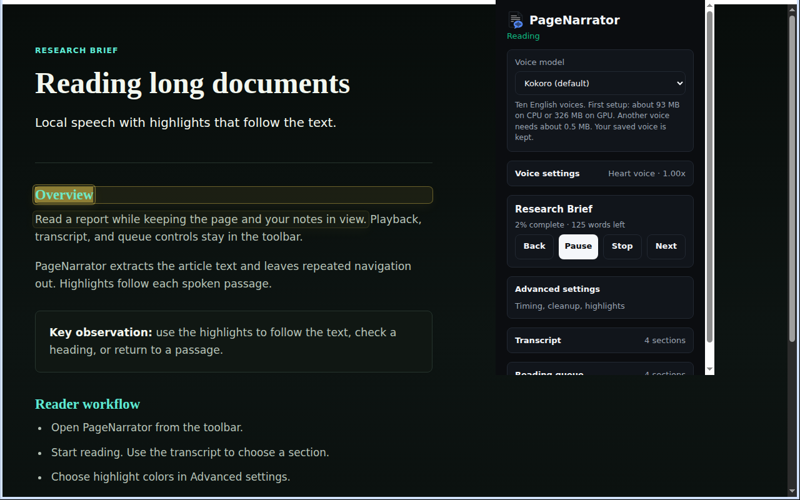

# PageNarrator — Private Text-to-Speech for Webpages and PDFs

Free text-to-speech (TTS) extension for Chrome and desktop Chromium browsers, with open-source application code. Read webpages, selected text, and PDFs aloud with on-device AI voices.

> **Hardware recommendations:** a dedicated GPU is recommended for multilingual voices and voice cloning. These features require WebGPU with fp16 support. Compatible integrated GPUs may work, but performance has not been verified. Kokoro's English voices also work on CPU, with longer startup times and possible pauses between sections.
>
> The suggested 8 GB+ VRAM and 8 GB+ system RAM setup is provisional, not a tested minimum. See [hardware recommendations](docs/requirements-hardware.md) for CPU guidance and compatibility details.

[Download v1.0.5](https://github.com/FelixCAxO/PageNarrator/releases/download/v1.0.5/pagenarrator-1.0.5.zip) · [Source ZIP](https://github.com/FelixCAxO/PageNarrator/releases/download/v1.0.5/pagenarrator-1.0.5-source.zip) · [Website](https://pagenarrator.com) · [Support](https://pagenarrator.com/support)

Independent listening reviews and physical hardware tests were not performed for v1.0.5. The maintainer waived these two checks; listening quality and hardware performance remain unverified. [Verification report](https://github.com/FelixCAxO/PageNarrator/releases/download/v1.0.5/pagenarrator-1.0.5-verification.md)

- **Private and offline:** narration stays on your device. Cached voices work offline until the cache is cleared or evicted.
- **Free without quotas:** no account, subscription, or usage quota.
- **Read along and resume:** synchronized word highlights, transcript navigation, saved positions, and 0.5×–3× speed. Playback continues when you close the popup.
- **PDFs, including scans:** read online and local PDFs. Scans use local English OCR; accuracy depends on scan quality and layout.
- **Voice choice:** 831 OmniVoice voices in 32 languages, ten English Kokoro voices, and local voice cloning.



## Install

1. Download and extract the extension ZIP above.
2. Open your browser's Extensions page (`chrome://extensions`, `edge://extensions`, or `brave://extensions`) and enable **Developer mode**.
3. Choose **Load unpacked** and select the folder containing `manifest.json`.
4. Open a webpage, click PageNarrator, and choose **Read page**. Wait for the first voice download and setup.

For local PDFs, enable **Allow access to file URLs** in the extension's details. [Reader guide and updates](docs/reader-ui.md).

Chrome Web Store availability is pending. Incognito is disabled.

## Browser and hardware support

Requires desktop Chromium 120+. Edge, Brave, Opera, and Vivaldi compatibility is expected but not separately verified; automated browser tests use Chromium.

Kokoro supports WebGPU and a slower CPU fallback. OmniVoice requires WebGPU with fp16 and a separate ~1.35 GB download. See [hardware recommendations](docs/requirements-hardware.md) and [voice details](docs/multilingual-tts.md).

## Privacy

Voice downloads send Hugging Face your IP address and file requests. Narration and resume data stay local. Online PDFs load from their host. PageNarrator does not request always-on website access. [Privacy policy](https://pagenarrator.com/privacy) · [Security](docs/SECURITY.md).

## Repository map

| Folder | What lives here |
| --- | --- |
| [src/](src/) | Extension UI, reading, speech, and PDF code |
| [extension/](extension/) | Chrome manifest, runtime assets, translations, and icon artwork |
| [engines/](engines/) | Native sources, reference binaries, and vendored data |
| [tooling/](tooling/) | Build, release, benchmark, and maintenance tools |
| [tests/](tests/) | Test suites and fixtures |
| [website/](website/) | Website templates, translations, generated pages, and Cloudflare config |
| [docs/](docs/) | Architecture, guides, [changelog](docs/CHANGELOG.md), and release documentation |

## Build and test

Use Node.js **26.12.1** with **npm 12.2.1**. `.nvmrc` selects the tested Current release; update npm with `npm install --global npm@12.2.1`.

The supported ranges are 22.23.4–22.x, 24.22.1–24.x and 26.12.1 or newer, matching the dependency engine requirements. Build locally:

```sh
npm ci
npm run build
```

Load `dist/` as an unpacked extension.

| Command | Purpose |
| --- | --- |
| `npm test` | Run the unit suite |
| `npm run verify:fast` | Run the local verification gate |
| `npm run preview` | Build and launch the extension in a local browser |
| `npm run build:website` | Regenerate localized pages and stage the site |
| `npm run package` | Build the extension and matching source ZIPs |

See [contributing and tests](docs/CONTRIBUTING.md), [architecture](docs/project-architecture.md), and [release notes](https://github.com/FelixCAxO/PageNarrator/releases/tag/v1.0.5).

## Licenses and redistribution

PageNarrator's code is GPL-3.0-or-later. OmniVoice source code is Apache-2.0. The separately downloaded pretrained weights are CC BY-NC. [PageNarrator license](LICENSE) · [OmniVoice source license](https://github.com/k2-fsa/OmniVoice/blob/master/LICENSE) · [Voice licenses](docs/third-party-voice-licenses.md)

**OmniVoice audio codec.** Built with Higgs Materials licensed from Boson AI USA, Inc., Copyright Boson AI USA, Inc., All Rights Reserved and Meta Llama 3 licensed under the Meta Llama 3 Community License, Copyright Meta Platforms, Inc., All Right Reserved. Based on Meta Llama 3. Built with Meta Llama 3. [Boson agreement](extension/public/legal/Boson-Higgs-Audio-2-LICENSE.txt) · [Meta agreement](extension/public/legal/Meta-Llama-3-LICENSE.txt)

Distribute the matching source ZIP with the extension and keep the [third-party notices](extension/public/legal/THIRD_PARTY_NOTICES.txt). Both ZIPs exclude downloaded speech weights.

[Support mailbox setup](docs/support-mailbox.md) to reply as `support@pagenarrator.com` (`website/workers/support-mailbox.js`).
