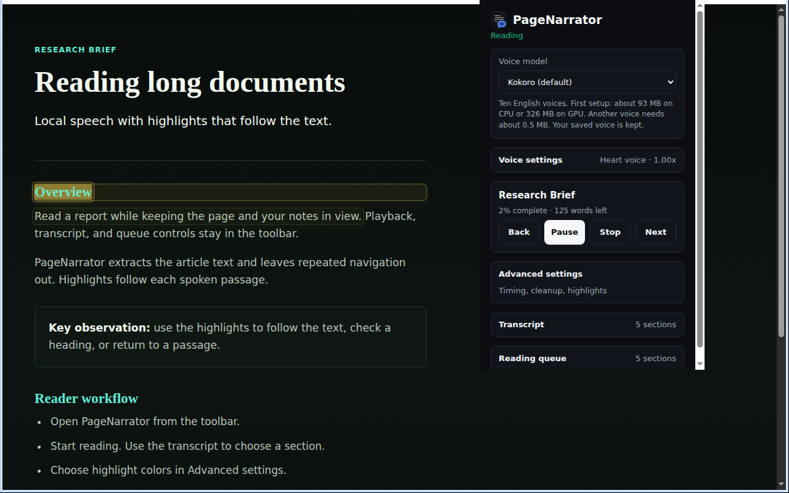

# PageNarrator — Private Text-to-Speech for Webpages and PDFs

Free, open-source text-to-speech (TTS) extension for Chrome and desktop Chromium browsers. Read webpages, selected text, and PDFs aloud with on-device AI voices.

[Download v1.0.2](https://github.com/FelixCAxO/PageNarrator/releases/download/v1.0.2/pagenarrator-1.0.2.zip) · [Source ZIP](https://github.com/FelixCAxO/PageNarrator/releases/download/v1.0.2/pagenarrator-1.0.2-source.zip) · [Website](https://pagenarrator.com) · [Support](https://pagenarrator.com/support)

- **Private and offline:** narration stays on your device. Cached voices work offline after setup.
- **Free without quotas:** no account, subscription, or usage quota.
- **Read along and resume:** synchronized word highlights, transcript navigation, saved positions, and 0.5×–3× speed. Playback continues when you close the popup.
- **PDFs, including scans:** read online and local PDFs. Scans use local English OCR; accuracy depends on scan quality and layout.
- **Voice choice:** ten English Kokoro voices, plus experimental OmniVoice speech in 32 languages.



## Install

1. Download and extract the extension ZIP above.
2. Open your browser's Extensions page (`chrome://extensions`, `edge://extensions`, or `brave://extensions`) and enable **Developer mode**.
3. Choose **Load unpacked** and select the folder containing `manifest.json`.
4. Open a webpage, click PageNarrator, and choose **Read page**. Wait for the first voice download and setup.

For local PDFs, enable **Allow access to file URLs** in the extension's details. [Reader guide and updates](docs/reader-ui.md).

Chrome Web Store availability is pending. Incognito is disabled.

## Browser and hardware support

Requires desktop Chromium 120+. Edge, Brave, Opera, and Vivaldi compatibility is expected but not separately verified; automated browser tests use Chromium.

Kokoro supports WebGPU and a slower CPU fallback. OmniVoice requires WebGPU with fp16 and a separate ~1.35 GB download. See [hardware recommendations](docs/requirements-hardware.md) and [voice details](docs/multilingual-tts.md).

## Privacy

Missing voice files download from Hugging Face; hosts receive your IP address and requested file paths, not narration text. Offline use needs the same cached voice and processing mode; clearing storage may require another download. Online PDFs are fetched from their host. Resume data stays local. PageNarrator does not request always-on website access. [Privacy policy](https://pagenarrator.com/privacy) · [Security](SECURITY.md).

## Build and test

Use Node.js **22.13+ (22.x) or 24+**:

```sh
npm ci
npm run build
```

Load `dist/` as an unpacked extension. See [contributing and tests](CONTRIBUTING.md), [architecture](docs/project-architecture.md), and [release notes](https://github.com/FelixCAxO/PageNarrator/releases/tag/v1.0.2).

Original code: [GPL-3.0-or-later](LICENSE); combined distribution: GPLv3. Keep [third-party notices](public/legal/THIRD_PARTY_NOTICES.txt) and distribute the matching source ZIP with the extension. [License details](docs/third-party-voice-licenses.md).

[Support mailbox setup](docs/support-mailbox.md) to reply as `support@pagenarrator.com` (`website/workers/support-mailbox.js`).
