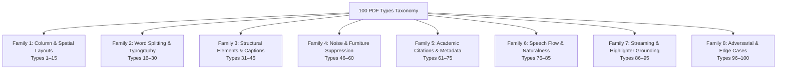

# 100 PDF layout types

The 100-type layout and column suite is in `tests/pdf/pdf-100-types-flow-benchmark.test.js`.

Every test case creates binary PDF files (via `tests/helpers/pdf-test-generator.js`) or loads fixed fixtures from disk. The ordinary suite uses the isolated PDF.js development oracle with PageNarrator's extraction/streaming code. `node scripts/test-original-pdf-corpus.mjs` runs these unchanged assertions through the original facade selected by the extension, with source hashes and document-disposal records.

Checks cover order, columns, tables, lists, soft wraps, metadata filtering, stream limits, and highlight mapping. These generated cases do not replace human naturalness ratings or independent-document review.

---

## Layout families

Eight families cover the 100 types:



---

## Type list

### Family 1: Column & Spatial Layouts (Types 1–15)
1. **Single-Column Prose**: Standard single-column document flowing top-to-bottom.
2. **Two-Column Symmetric LTR**: Equal-width two-column layout reading left column top-to-bottom before starting right column.
3. **Two-Column Asymmetric (Wide Left / Narrow Right)**: Main content in wide left column, side notes in narrow right column.
4. **Two-Column Asymmetric (Narrow Left / Wide Right)**: Sidebar index in narrow left column, body narrative in wide right column.
5. **Three-Column Standard LTR**: Magazine/newspaper 3-column layout reading col 1, col 2, col 3.
6. **Two-Column Symmetric RTL**: Arabic/Hebrew 2-column layout reading right column before left column.
7. **Three-Column RTL**: Arabic/Hebrew 3-column layout reading columns right-to-left.
8. **Mixed-Direction Bilingual**: English LTR paragraphs mixed with Arabic RTL paragraphs.
9. **Full-Width Spanning Header**: Banner title spanning both columns preceding column bodies.
10. **Full-Width Spanning Footer**: Concluding section spanning across both columns read after both columns finish.
11. **Uneven Baseline Columns**: Columns with differing vertical bottom baselines.
12. **In-Column Section Heading**: Numbered section headings inside a column kept with that column's narrative.
13. **Multi-Column Margin Metadata**: Right-aligned document header metadata at top margin.
14. **Cross-Column Sentence Wrap**: Unfinished sentence at bottom of left column joining cleanly with top of right column.
15. **Centered Callout / Pull Quote**: Interleaved callout block positioned between columns.

### Family 2: Word Splitting & Typography (Types 16–30)
16. **Soft Hyphen Line-Wrap**: Line-wrap soft hyphen (`inter-\nnational`) reassembled into a single spoken word (`international`).
17. **Hard Hyphen Compound**: Intentional hyphenated compound across lines (`state-\nof-the-art`) preserved with hyphen.
18. **Spaced Hyphen Line-Wrap**: Reassembling broken prefixes across lines.
19. **Consecutive Hyphenated Lines**: Multiple consecutive line-end hyphens all resolving cleanly.
20. **Unicode Hyphen Variants**: U+2010 hyphen, U+2013 en-dash, U+2014 em-dash normalized for speech synthesis.
21. **Non-English Diacritics**: Accented characters (`é`, `ü`, `ñ`, `ç`, `ø`, `å`) preserved intact without corruption.
22. **2-Line Drop Cap**: Single-letter drop cap spanning 2 lines attached to initial word.
23. **3-Line Drop Cap**: Multi-line drop cap positioned before first narrative sentence.
24. **Multi-Letter Decorative Drop Cap**: Multi-glyph decorative opening (`T HE`) attached to paragraph.
25. **Small-Caps Header**: Glyphs rendered in small-caps reassembled into unified header.
26. **Letter-Spaced Title**: Widely spaced header glyphs (`A B S T R A C T`) preserved as heading.
27. **Raised Glyphs / Baseline Shift**: Raised letters/numbers aligned with text baseline without line fragmentation.
28. **Chemical Formula Subscripts**: Molecular formulas (`H2O`, `CO2`) preserving token continuity.
29. **Mathematical Superscripts**: Exponents (`r^2`, `x^3`) preserved as math tokens.
30. **Terminal Math Variables**: Single-letter variables (`v.`, `x = y`) before punctuation staying in sentence.

### Family 3: Structural Elements & Captions (Types 31–45)
31. **2x3 Standard Data Table**: Row-major table extraction with terminal pause periods between rows.
32. **Table with Numeric Data**: Multiple columns of decimals and integers aligned by row.
33. **Full-Width Spanning Table**: Wide table spanning across multiple columns.
34. **Multi-Line Cell Table**: Table cells containing wrapped multi-line text kept ordered.
35. **Bullet List (• Symbol)**: Bullet items stripped of bullet symbol and joined with structural pause semicolons (`;`).
36. **Dash List (- Symbol)**: Dash list items formatted with list cadence.
37. **Asterisk List (* Symbol)**: Asterisk list items formatted with list cadence.
38. **Numbered List (1., 2.)**: Numbered list items retaining numeric prefix with semicolon pause.
39. **Alphanumeric List ((a), (b))**: Lettered sub-items formatted with semicolon pause.
40. **Roman Numeral List ((i), (ii))**: Roman numeral list items formatted properly.
41. **Multi-Line List Continuation**: Sub-lines indented under a list item merged into a single spoken thought.
42. **Interleaved Figure Caption**: Figure caption placed between interrupted paragraph sentences deferred after prose.
43. **Multi-Sentence Figure Caption**: Multi-sentence descriptive figure caption kept intact.
44. **Table Caption Preceding Table**: Table caption positioned directly before table rows.
45. **Side-by-Side Subfigures**: Sub-captions `(a)` and `(b)` read in spatial order.

### Family 4: Noise & Furniture Suppression (Types 46–60)
46. **Running Header at Top Margin**: Header text near top page boundary suppressed from speech.
47. **Running Footer at Bottom Margin**: Footer text near bottom page boundary suppressed from speech.
48. **Page Number at Bottom Center**: Standalone integer page numbers suppressed.
49. **Page Number at Top Corner**: Top-right / top-left corner page numbers suppressed.
50. **Roman Numeral Page Number**: Prefatory Roman numerals (`iv`, `xii`) suppressed.
51. **Repeated Document Title**: Recurring running title across pages filtered.
52. **Confidentiality / Draft Banner**: "Draft Copy - Do Not Distribute" watermarks suppressed.
53. **arXiv Identifier Banner**: `arXiv:XXXX.XXXXXv1 [cs.CL]` margin banner suppressed.
54. **Copyright Notice in Footer**: `Copyright © 2026 IEEE` footer notice filtered.
55. **Creative Commons License**: `CC-BY 4.0` license disclaimer text filtered.
56. **Conference Submission Notice**: "Submitted to INTERSPEECH 2026 for review" banner filtered.
57. **Author Affiliation Block**: University/department address blocks filtered from narration.
58. **Author Contact Emails**: Inline email addresses stripped from spoken narration.
59. **ORCID Identifiers**: `0000-0002-XXXX-XXXX` identifier strings stripped from spoken narration.
60. **Web URL Tokens**: `https://github.com/...` URLs stripped from spoken narration.

### Family 5: Academic Citations & Metadata (Types 61–75)
61. **Single Numeric Citation [1]**: Bracketed citation number stripped from speech.
62. **Multi-Bracket Citation [1, 2, 3]**: Comma-separated bracketed citations stripped.
63. **Citation Range [1–5]**: Hyphenated citation range stripped from speech.
64. **Author-Year In-Text Citation**: `(Smith et al., 2024)` stripped from speech.
65. **Bare Author-Year Citation**: `Vaswani et al., 2017` stripped from speech.
66. **Parenthetical Year Citation**: `Smith et al. (2024)` handled cleanly.
67. **Multi-Author Citation**: `(Bengio and LeCun, 2020)` stripped from speech.
68. **Publication Month & Year**: Valid date `January 2025` preserved in speech.
69. **Section Header with Numbering**: `1. Introduction` formatted with colon pause.
70. **Deep Subsection Heading**: `3.2.1 Data Collection Protocol` formatted with colon pause.
71. **Abstract Header & Block**: Abstract heading and body block formatted cleanly.
72. **Keywords / Index Terms**: `Index Terms: ...` block formatted properly.
73. **Footnote Text at Bottom Margin**: Bottom margin footnote classified and formatted.
74. **Acknowledgments Section**: Acknowledgments section header and narrative.
75. **References Section**: References heading classified as title.

### Family 6: Speech Flow & Naturalness (Types 76–85)
76. **Title Structural Pause**: Title line ending with colon (`:`) to separate title from body in audio.
77. **List Item Semicolon Cadence**: List items separated with semicolons (`;`) for distinct rhythmic pauses.
78. **Table Row Periods**: Table rows ending with periods (`.`) for row-by-row audio pauses.
79. **Decimal Number Protection**: `3.14159` preserved without premature sentence splitting.
80. **Percentage Number Protection**: `99.9%` and `0.05%` preserved without breaking sentences.
81. **Time Expression Protection**: `10:30 AM` and `14:00 UTC` kept unbroken.
82. **Academic Abbreviation Protection**: `et al.`, `e.g.`, `i.e.` prevented from triggering false sentence breaks.
83. **Honorific Abbreviation Protection**: `Dr.`, `Prof.`, `Mr.`, `Ms.` prevented from breaking sentences.
84. **Citation Label Abbreviation Protection**: `Fig. 1`, `Tab. 2`, `Eq. 4`, `Sec. 3` kept intact.
85. **Clause-Boundary Splitting**: Long compound sentences split at natural clause boundaries (`,`, `;`, `:`) under `maxLen`.

### Family 7: Streaming & Highlighter Grounding (Types 86–95)
86. **Multi-Page Streaming Iterator**: Page-by-page chunk iterator emitting `pdf-page` chunks sequentially.
87. **Single-Page Immediate Yield**: Fast first-chunk playback without waiting for multi-page sampling buffers.
88. **Start Reading from Page N**: Designated start page navigation (`startPage: 5`) beginning stream directly at page N.
89. **Streaming Chunk maxLen Cap**: Strict adherence to speech chunk length limits.
90. **Streaming Chunk targetMinLen Grouping**: Grouping short sentences into cohesive audio chunks.
91. **DOM Order Attribute Tagging**: Text layer spans tagged with `data-pagenarrator-pdf-order`.
92. **DOM Narrated Flag Tagging**: Spans marked with `data-pagenarrator-pdf-narrated`.
93. **DOM Anchor ID Assignment**: Chunks anchored to `pdf-page-N` DOM elements.
94. **Monotonic DOM Word Offset**: Strictly monotonic word offset tracking across split speech chunks.
95. **Spoken-to-DOM Word Mapping**: 1-to-1 word index alignment between TTS audio and visual DOM highlighter spans.

### Family 8: Adversarial & Edge Cases (Types 96–100)
96. **Scanned Image-Only PDF**: Scanned raster PDF detection throwing `scanned_pdf_unsupported`.
97. **Vector-Only PDF**: Vector graphics PDF without text returning clean empty text.
98. **Blank Page Handling**: Empty page returning empty speech without throwing errors.
99. **Oversized Single Word**: Pathological single word exceeding `maxLen` splitting on character boundaries.
100. **Compact Fragment Page**: Sparse page with `<= 5` text items preserving fragments cleanly.

---

## Run the tests

Run all 100 cases:

```powershell
npx vitest run tests/pdf/pdf-100-types-flow-benchmark.test.js
```
